# 汽车研发工程质量管理平台 (Engineering Quality Lab) 系统架构与 ER 模型设计

## 一、系统架构总览

本平台（EQL）是专为汽车车身开闭件（前门、后门、车窗、电动尾门、铰链）与气密/水密密封系统打造的闭环研发工程质量管理系统。平台采用前后端分离架构与高性能单体分层设计，确保高内聚、低耦合与高吞吐量。

### 1.1 分层架构

```
┌──────────────────────────────────────────────────────────┐
│              Web 前端 (React 18 + TypeScript + Vite)     │
│   Dashboard · Programs · Parts · DFMEA · DVP&R · Tests   │
│   Issues · 5-Why Analysis · ECR Changes · Knowledge Base │
└────────────────────────────┬─────────────────────────────┘
                             │ HTTP / JSON API (RESTful)
┌────────────────────────────▼─────────────────────────────┐
│                 FastAPI 后端服务 (Python 3.12)           │
│  ├── API 路由层 (10 个业务模块路由 + Pydantic v2 参数校验) │
│  ├── 业务服务层 (AIAG-VDA AP 判定引擎 / 状态机 / 成本联动) │
│  └── 核心中间件 (CORS / 全局异常捕获 / 日志追踪)           │
└────────────────────────────┬─────────────────────────────┘
                             │ SQLAlchemy 2.0 ORM (Eager joinedload)
┌────────────────────────────▼─────────────────────────────┐
│             SQLite 3 数据库引擎 (WAL 并发模式)            │
│  ├── 外键约束 (PRAGMA foreign_keys = ON)                 │
│  ├── 预写日志与轻量同步 (WAL + synchronous = NORMAL)       │
│  └── 复合高频分析索引 (Compound Indexes)                 │
└──────────────────────────────────────────────────────────┘
```

---

## 二、数据库实体关系 (ER) 模型

```mermaid
erDiagram
    PROGRAMS ||--o{ PARTS : "1:N has parts"
    PROGRAMS ||--o{ DVPRS : "1:N plans"
    PROGRAMS ||--o{ ISSUES : "1:N issues"
    PROGRAMS ||--o{ CHANGES : "1:N ECR changes"

    PARTS ||--o{ DFMEAS : "1:N FMEA items"
    PARTS ||--o{ DVPRS : "1:N verification plans"
    PARTS ||--o{ ISSUES : "1:N component issues"
    PARTS ||--o{ CHANGES : "1:N change orders"

    DVPRS ||--o{ TEST_RUNS : "1:N executes"
    TEST_RUNS ||--o| ISSUES : "1:1 triggers on failure"

    ISSUES ||--o| ROOT_CAUSES : "1:1 5-Why analysis"
    ISSUES ||--o| CHANGES : "1:1 corrective change"

    KNOWLEDGE_ITEMS {
        int id PK
        string doc_code UK
        string title
        string subsystem
        string category
        string tags
        text content
        text keywords
        string author
    }

    PROGRAMS {
        int id PK
        string code UK
        string name
        string platform
        string phase
        string sop_date
        string lead_engineer
        string quality_manager
        string target_market
    }

    PARTS {
        int id PK
        int program_id FK
        string part_number UK
        string name
        string subsystem
        string category
        string supplier
        string material
        string revision
        float weight_kg
        boolean safety_critical
    }

    DFMEAS {
        int id PK
        int part_id FK
        string fmea_code UK
        text item_function
        text failure_mode
        text failure_effect
        int severity
        text cause_mechanism
        int occurrence
        text prevention_control
        text detection_control
        int detection
        int rpn
        string action_priority
        string action_status
    }

    DVPRS {
        int id PK
        int program_id FK
        int part_id FK
        string plan_code UK
        string test_phase
        string test_name
        string test_standard
        text acceptance_criteria
        int sample_size
        string test_facility
        string status
        string responsible_engineer
    }

    TEST_RUNS {
        int id PK
        int dvpr_id FK
        string run_number UK
        string sample_id
        string test_date
        string test_facility
        float temperature_c
        float humidity_rh
        int cycles_completed
        text measurement_data
        string result
        text failure_summary
    }

    ISSUES {
        int id PK
        string issue_code UK
        int program_id FK
        int part_id FK
        int test_run_id FK
        string title
        string severity
        string status
        text description
        string occurrence_phase
        text containment_action
        string assignee
        string due_date
        string closure_date
    }

    ROOT_CAUSES {
        int id PK
        int issue_id FK
        string analysis_method
        text direct_cause
        text why_1
        text why_2
        text why_3
        text why_4
        text why_5
        text systemic_root_cause
        string verification_result
        string analyst
    }

    CHANGES {
        int id PK
        string change_code UK
        int program_id FK
        int part_id FK
        int issue_id FK
        string title
        string change_type
        text reason
        string pre_change_rev
        string post_change_rev
        float cost_impact_rmb
        float weight_impact_kg
        int tooling_lead_weeks
        string approval_status
    }
```



---

## 三、核心算法与业务逻辑设计

### 3.1 AIAG & VDA (2019 第1版) 行动优先级 (Action Priority) 判定引擎
传统汽车研发仅依赖 $RPN = S \times O \times D$，容易出现 $S=9, O=2, D=2 (RPN=36)$ 被忽视的重大安全隐患。
系统实现了标准 AIAG-VDA 逻辑：
- 严重度 $S \in [9, 10]$ 且频度 $O \ge 4$ 或探测度 $D \ge 7$ 时，强制锁定为 **High AP (高风险必须整改)**。
- 保证法规件（如车窗防夹力 ECE R21、门锁碰撞脱开 FMVSS 206）不发生漏控。

### 3.2 试验失效与 PRTS 工程问题联动
当台架试验结果为 `Fail` 时：
1. 自动更新对应 DVP&R 验证计划状态为 `Failed`；
2. 支持一键或接口直接将试验单号、极端工况遥测数据（下垂量、防夹力、漏水流量）转为工程问题单（PRTS Ticket）；
3. 状态闭环保护：未填写根本原因或未通过对策验证的问题单，禁止标记为 `Closed`。

### 3.3 工程变更 (ECR) 与零件版本版本自动迭代
当 ECR 审批流转至 `Implemented`（已执行）时，系统自动联动将关联零部件数据库中的图纸版本从 `pre_change_rev`（如 Rev A.0）自动升级为 `post_change_rev`（如 Rev B.0），保证前后端 engineering bill of materials (BOM) 一致性。
