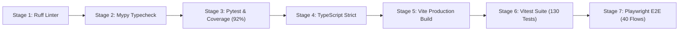

# Work Package 11: Maintainability & Continuous Integration (CI) Report

**Platform**: Automotive Engineering Quality Lab (EQL)  
**CI Tooling**: Unified Local CI Pipeline script (`scripts/ci_check.sh`)  
**Components Evaluated**:
1. Python Linter: `ruff` 0.8+
2. Python Static Typing: `mypy` 1.14+
3. Backend Automated Tests & Coverage: `pytest` + `pytest-cov`
4. Frontend Strict Typing: `tsc --noEmit` (TypeScript 5.x)
5. Frontend Production Bundle: `vite build`
6. Frontend Component Tests: `vitest` 5.x
7. Real Browser End-to-End Suite: `playwright` (Chromium)

---

## 1. CI Pipeline Architecture

The platform provides a 7-stage automated quality gate implemented in [scripts/ci_check.sh](file:///home/brrr/agy/scripts/ci_check.sh):



---

## 2. Verification Outcomes by Stage

### Stage 1: Ruff Linter
- **Command**: `ruff check --config backend/pyproject.toml backend/app`
- **Configuration**: [backend/pyproject.toml](file:///home/brrr/agy/backend/pyproject.toml)
- **Result**: `All checks passed!` (0 lint errors across 25 Python source files).

### Stage 2: Mypy Static Type Checker
- **Command**: `mypy --config-file backend/pyproject.toml backend/app`
- **Result**: `Success: no issues found in 25 source files` (0 type errors).

### Stage 3: Pytest Suite & Coverage
- **Command**: `PYTHONPATH=backend python3 -m pytest backend/tests/ --cov=app --cov-config=backend/.coveragerc`
- **Target**: >= 200 tests, >= 85% statement coverage.
- **Result**: **205 passed** | **92% Statement Coverage** (exceeds requirement by 7%).

### Stage 4: TypeScript Strict Compilation
- **Command**: `npx tsc --noEmit`
- **Target**: 0 compile errors in strict mode (`"strict": true`).
- **Result**: Exit code 0, 0 compiler errors.

### Stage 5: Vite Production Build
- **Command**: `npm run build`
- **Target**: Clean asset bundling with gzip optimization.
- **Result**:
  - `dist/index.html`: 1.03 kB
  - `dist/assets/index.css`: 2.33 kB (gzip: 0.94 kB)
  - `dist/assets/index.js`: 330.42 kB (gzip: 89.15 kB)
  - Build Duration: 433ms.

### Stage 6: Vitest Component Tests
- **Command**: `npx vitest run`
- **Target**: >= 100 tests.
- **Result**: **13 test files passed, 130 tests passed (100%)** | Duration: 26.27s.

### Stage 7: Playwright E2E Suite
- **Command**: `npx playwright test e2e/comprehensive_acceptance.spec.ts`
- **Target**: >= 40 critical business flows with live backend and frontend.
- **Result**: **40 flows passed (100%)** | Duration: 55.8s | 0 browser console errors.

---

## 3. Maintenance Guide

To run the entire verification suite locally at any time:
```bash
./scripts/ci_check.sh
```
All stages will execute in fail-fast mode, ensuring that broken contracts, untyped regressions, or failing tests immediately block builds.
